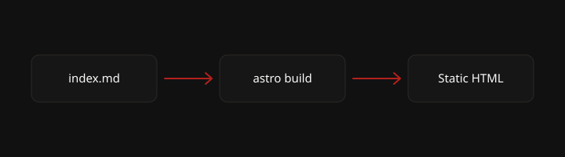

This is a placeholder. It exists to check how each element renders, and it doubles as a reference for the syntax. Paragraphs can contain **strong text**, *emphasis*, `inline code`, ~~struck text~~ and [links](https://astro.build).

## Code blocks

A fenced block with a language gets syntax highlighting:

```ruby
class Timer
  def initialize(seconds)
    @seconds = seconds
  end

  def expired?(now = Time.current)
    now >= started_at + @seconds
  end
end
```

Add a `title` to show a file name above the block:

```js title="app/javascript/controllers/timer_controller.js"
import { Controller } from "@hotwired/stimulus"

export default class extends Controller {
  static values = { seconds: Number }

  connect() {
    this.startedAt = Date.now()
  }
}
```

Long lines scroll sideways instead of wrapping:

```sh
curl --silent --fail --location "https://example.com/a/very/long/url/that/keeps/going/and/going/until/it/overflows" --output result.json
```

## Quotes

A plain quote:

> Simplicity is prerequisite for reliability.

A quote with its source. The last line starts with an em dash:

> Programs must be written for people to read, and only incidentally for machines to execute.
>
> — Harold Abelson, *Structure and Interpretation of Computer Programs*

## Footnotes

A claim that needs a source gets a footnote.[^source] A second one shows the numbering.[^second]

[^source]: The note itself can contain `code` and [links](https://example.com).
[^second]: Notes are collected at the end of the article, in order.

## Images

Images live next to the article's `index.md`. A title in quotes becomes the caption:


SVG files work the same way:



## Lists and tables

- A bullet
- Another bullet
  - A nested bullet
- [x] A finished task
- [ ] An open task

1. First step
2. Second step

| Feature     | Syntax               | Notes                    |
| ----------- | -------------------- | ------------------------ |
| Code title  | `title="file.rb"`    | Shown above the block    |
| Caption     | ``| Image alone on its line  |
| Attribution | `> — Name`           | Last line of the quote   |

---

### A third-level heading

Text after a horizontal rule, under a smaller heading.
